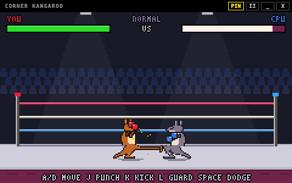

# Corner Kangaroo

화면 구석에 작은 복싱 링을 하나 띄워둡니다.
코드를 짜다가, 문서를 쓰다가 잠깐 손이 비면 캥거루로 펀치와 킥을 몇 번 날리면 됩니다. 창은 다른 창 위에 떠 있지만 480×300 크기라서 하던 일을 가리지 않습니다.



## 모드

앱을 켜면 모드 선택 화면이 나옵니다. A/D로 고르고 Enter(또는 J)를 누르거나 카드를 클릭합니다. 게임 중에 Esc 메뉴의 `MODE SELECT`로 돌아올 수 있습니다. 모드를 바꾸면 이전 모드의 체력, 점수, 콤보는 모두 지워집니다.

### 스파링

CPU 캥거루와 1:1로 싸웁니다. 상대의 체력을 먼저 0으로 만들면 이깁니다. 라운드나 시간 제한은 없습니다.

### 샌드백

샌드백을 마음껏 때리는 연습 모드입니다. 샌드백은 반격하지 않고 부서지지도 않습니다. 맞힌 횟수, 펀치·킥 명중 수, 콤보, 점수, 연습 시간이 화면에 나옵니다.

- **자유 연습**: 시간 제한 없이 칩니다. 처음 들어가면 자유 연습입니다.
- **타임 어택**: T를 누르면 30초 동안 최대한 높은 점수를 노리는 타임 어택이 시작됩니다. 시간이 끝나면 더 칠 수 없고 최종 점수, 맞힌 횟수, 최고 콤보가 나옵니다. 다시 T를 누르면 자유 연습으로 돌아갑니다.

## 조작

| 키 | 스파링 | 샌드백 |
| --- | --- | --- |
| A / D | 좌우로 움직입니다 | 좌우로 움직입니다 |
| W | 꼬리로 바닥을 차고 점프 | 꼬리로 바닥을 차고 점프 |
| S | 누르고 있는 동안 앉기 | 누르고 있는 동안 앉기 |
| J | 펀치 | 펀치 |
| K | 킥 | 킥 |
| L | 누르고 있는 동안 가드 (S와 함께 누르면 앉아 가드) | 쓰지 않습니다 |
| Space | 뒤로 피하기 | 쓰지 않습니다 |
| R | 처음부터 다시 | 기록을 지우고 다시 |
| T | | 자유 연습 / 타임 어택 바꾸기 |
| Esc | 멈추고 메뉴 열기 | 멈추고 메뉴 열기 |

방향키(← → ↑ ↓)로도 움직일 수 있습니다. 창은 맨 위 검은 막대를 잡고 끌어서 옮깁니다. 게임 화면은 창 이동에 쓰이지 않아서 클릭이 막대와 섞이지 않습니다.

### 기술표

철권과 스트리트 파이터처럼 방향키와 버튼을 함께 눌러 기술을 씁니다. "앞"은 상대 쪽입니다. 오른쪽을 보고 있으면 D, 왼쪽을 보고 있으면 A입니다. 게임 중 Esc 메뉴의 `MOVE LIST`에서도 볼 수 있습니다.

| 입력 | 기술 | 높이 | 특징 |
| --- | --- | --- | --- |
| J | 잽 | 상단 | 빠르지만 앉은 상대에게는 닿지 않습니다 |
| K | 킥 | 중단 | 뒷다리로 찹니다 |
| S + J | 로우 잽 | 하단 | 가장 빠른 공격 |
| S + K | 꼬리 스윕 | 하단 | 꼬리로 바닥을 쓸어 상대를 넘어뜨립니다 |
| S + 앞 + J | 어퍼컷 | 중단 | 솟아오르는 동안 점프 공격과 상단 공격을 맞지 않습니다. 맞히면 상대가 떠오릅니다 |
| S, 앞 + J | 파워 스트레이트 | 중단 | 아래를 눌렀다가 앞으로 밀면서 펀치. 앞으로 돌진합니다 |
| S, 앞 + K | 꼬리 드롭킥 | 중단 | 꼬리로 버티고 두 발로 찹니다. 가장 세지만 빗나가면 오래 무방비입니다 |
| W | 꼬리 점프 | | 꼬리를 말았다가 튕겨 오릅니다. 하단 공격을 넘을 수 있습니다 |
| 공중에서 J / K | 점프 펀치 / 점프 킥 | 공중 | 점프 한 번에 한 번만 씁니다 |

## 규칙

### 펀치는 빠르고, 킥은 멀리 세게 갑니다

펀치는 바로 나가고 금방 다음 동작을 할 수 있지만 가까이 있어야 맞고 피해가 작습니다(6). 킥은 뒷다리를 들어 올리는 시간이 있지만 더 멀리 닿고 피해가 두 배입니다(12). 대신 킥을 헛치면 다시 움직일 때까지 시간이 걸려서 반격당하기 쉽습니다. 공격하는 동안에는 직접 움직일 수 없고(돌진하는 필살기는 앞으로 나갑니다), 공격이 끝나기 전에 누른 버튼은 무시됩니다. 방향키 입력은 기억해 두므로 공격이 끝나기 전에 필살기 입력을 미리 해둘 수 있습니다.

### 가드는 피해를 70% 줄입니다. 높이를 맞춰야 막힙니다

L을 누르고 있으면 글러브로 얼굴을 막습니다. 앞에서 오는 공격만 막고, 막는 동안에는 공격할 수 없습니다. 킥은 막아도 잠깐 몸이 굳습니다.

- 서서 막기(L)는 상단·중단·점프 공격을 막지만 하단(로우 잽, 꼬리 스윕)은 못 막습니다.
- 앉아 막기(S + L)는 중단·하단을 막지만 점프 공격은 못 막습니다.
- 앉아 있으면 상단 잽이 머리 위로 지나갑니다.
- 점프하면 하단 공격을 넘을 수 있지만, 공중에서 맞으면 넘어집니다.

### 넘어지면 잠깐 누워 있다가 일어납니다

꼬리 스윕, 어퍼컷, 꼬리 드롭킥에 맞거나 공중에서 맞으면 쓰러집니다. 일어나는 동안에는 맞지 않습니다.

### 피하기는 타이밍입니다

Space를 누르면 뒤로 빠르게 물러납니다. 물러나기 시작한 직후 0.18초 동안 들어온 공격은 완전히 빗나갑니다. 한 번 피하면 0.8초 동안 다시 피할 수 없어서, 상대가 공격하는 걸 보고 눌러야 합니다.

### CPU도 같은 규칙으로 싸웁니다

CPU는 거리를 재서 다가오고, 사거리 안에서 펀치·킥·하단 공격·필살기를 섞어 씁니다. 가끔 점프해서 들어오고, 내가 점프하면 어퍼컷으로 받아치기도 합니다. 내가 공격하면 조금 늦게 반응해서 높이에 맞춰 막거나 피하고, 체력이 낮아지면 조심스러워집니다. 가끔 거리를 잘못 재기도 합니다.

### 이기면 왕관을 씁니다

스파링에서 이긴 캥거루는 왕관을 쓰고 글러브를 들어 올립니다. Esc 메뉴의 `LEVEL`에서 EASY, NORMAL, HARD 중에 고를 수 있습니다.

### 샌드백 점수

잽은 10점, 킥은 25점이고 필살기일수록 높습니다(꼬리 드롭킥 50점). 점프 공격과 하단 공격도 샌드백에 맞습니다. 펀치 계열과 킥 계열은 따로 셉니다. 콤보가 이어질수록 한 번 칠 때 점수가 10%씩 더 붙습니다(최대 +100%). 1.2초 동안 아무것도 맞히지 못하거나 헛치면 콤보가 끊깁니다.

### 자리를 비우면 알아서 멈춥니다

다른 창을 클릭하면 게임이 멈추고, 누르고 있던 키도 모두 풀립니다. 멈춰 있는 동안에는 화면을 다시 그리지 않아서 CPU를 거의 쓰지 않습니다. 돌아와서 Esc를 누르면 이어서 합니다.

## 받기

아래 링크를 누르면 바로 내려받아집니다. 받은 파일이 바뀌지 않았는지는 [SHA256SUMS.txt](https://github.com/YunGyeongee/pocket-roo/releases/download/v1.0.0/SHA256SUMS.txt)로 확인할 수 있고, 지난 버전은 [Releases](https://github.com/YunGyeongee/pocket-roo/releases)에 있습니다.

| 컴퓨터 | 내려받기 |
| --- | --- |
| Mac (Apple Silicon) | [corner-kangaroo-1.0.0-mac-arm64.dmg](https://github.com/YunGyeongee/pocket-roo/releases/download/v1.0.0/corner-kangaroo-1.0.0-mac-arm64.dmg) |
| Windows 설치 파일 (x64, ARM 공통) | [corner-kangaroo-1.0.0-windows-setup.exe](https://github.com/YunGyeongee/pocket-roo/releases/download/v1.0.0/corner-kangaroo-1.0.0-windows-setup.exe) |
| Windows 압축 파일 (일반 PC) | [corner-kangaroo-1.0.0-windows-x64.zip](https://github.com/YunGyeongee/pocket-roo/releases/download/v1.0.0/corner-kangaroo-1.0.0-windows-x64.zip) |
| Windows 압축 파일 (ARM PC) | [corner-kangaroo-1.0.0-windows-arm64.zip](https://github.com/YunGyeongee/pocket-roo/releases/download/v1.0.0/corner-kangaroo-1.0.0-windows-arm64.zip) |

### macOS

Apple Silicon(M1 이상) Mac에서 실행됩니다. [corner-kangaroo-1.0.0-mac-arm64.dmg](https://github.com/YunGyeongee/pocket-roo/releases/download/v1.0.0/corner-kangaroo-1.0.0-mac-arm64.dmg)를 받습니다.

1. `.dmg`를 열고 Corner Kangaroo를 응용 프로그램 폴더로 끌어다 놓습니다.
2. 앱을 실행합니다. 아직 Apple 공증을 받지 않은 앱이라 처음에는 "확인되지 않은 개발자" 경고가 뜨고 열리지 않습니다.
3. **시스템 설정 → 개인정보 보호 및 보안**으로 가서 아래쪽의 **그래도 열기**를 누릅니다. 한 번만 하면 됩니다.
4. 화면 오른쪽 아래에 게임 창이 뜹니다. 모드를 고르고 Enter를 누르면 시작합니다.
5. 다른 창 위에 띄워두기 싫으면 위쪽의 `PIN` 버튼을 눌러 끕니다.
6. 끌 때는 위쪽의 `X` 버튼을 누르거나 Esc 메뉴에서 `QUIT`을 고릅니다.

3번이 안 되면 터미널에서 아래 명령을 한 번 실행해도 됩니다.

```bash
xattr -dr com.apple.quarantine "/Applications/Corner Kangaroo.app"
```

### Windows

Windows 10 이상에서 실행됩니다. [corner-kangaroo-1.0.0-windows-setup.exe](https://github.com/YunGyeongee/pocket-roo/releases/download/v1.0.0/corner-kangaroo-1.0.0-windows-setup.exe)를 받습니다. 설치 파일 하나로 일반 PC(x64)와 ARM PC를 모두 지원하고, 알아서 맞는 버전을 설치합니다.

1. 받은 설치 파일을 실행합니다.
2. 아직 코드 서명을 하지 않은 앱이라 "Windows의 PC 보호" 창이 뜹니다. **추가 정보**를 누른 뒤 **실행**을 누릅니다.
3. 관리자 권한 없이 내 계정에만 설치되고, 끝나면 바로 게임이 실행됩니다. 바탕화면과 시작 메뉴에 바로가기가 생깁니다.
4. 화면 오른쪽 아래에 게임 창이 뜹니다. 모드를 고르고 Enter를 누르면 시작합니다.
5. 다른 창 위에 띄워두기 싫으면 위쪽의 `PIN` 버튼을 눌러 끕니다.
6. 지울 때는 **설정 → 앱 → 설치된 앱**에서 Corner Kangaroo를 제거합니다.

설치하기 싫으면 `.zip`을 받아도 됩니다. 일반 PC는 [corner-kangaroo-1.0.0-windows-x64.zip](https://github.com/YunGyeongee/pocket-roo/releases/download/v1.0.0/corner-kangaroo-1.0.0-windows-x64.zip), ARM PC는 [corner-kangaroo-1.0.0-windows-arm64.zip](https://github.com/YunGyeongee/pocket-roo/releases/download/v1.0.0/corner-kangaroo-1.0.0-windows-arm64.zip)입니다. 압축을 풀고 `Corner Kangaroo.exe`를 실행하면 됩니다.

## 어떻게 만들었나

Electron, TypeScript, Vite로 만들었고 게임 엔진은 쓰지 않았습니다. 화면은 240×140 크기의 캔버스에 그린 다음 픽셀을 번지지 않게 키웁니다. Retina처럼 정수배로 딱 맞으면 정수배로, Windows의 125% 배율처럼 정수배로는 빈 테두리가 크게 남으면 창에 맞춰 키웁니다. Mac과 Windows가 같은 코드를 씁니다. 캥거루, 샌드백, 링, 글꼴까지 전부 코드 안의 작은 픽셀 배열로 그렸고 외부 그림 파일은 없습니다. 캥거루는 다리·몸통·머리·글러브를 따로 그려 동작마다 자리를 옮기는 방식이라, 나중에 스프라이트 시트로 바꿔도 게임 로직은 그대로 둘 수 있습니다.

전투는 1/120초 고정 간격으로 계산해서 화면 주사율과 상관없이 같은 공격이 같은 거리에서 맞습니다. 공격은 준비 → 타격 → 회복 구간으로 나뉘고, 타격 구간에서 한 번 맞으면 같은 공격으로 다시 맞지 않습니다. 플레이어와 CPU의 공격이 같은 순간에 맞으면 둘 다 맞습니다. 스파링과 샌드백은 같은 판정 코드를 쓰고, 맞은 뒤의 처리(체력 감소 / 점수 기록)만 모드별로 다릅니다.

게임 로직(`src/game`, `src/entities`, `src/modes`)은 화면과 분리되어 있어서 테스트에서 CPU끼리 끝까지 싸우게 할 수 있습니다. 렌더러는 Node.js에 접근할 수 없고, 창 제어에 필요한 기능 네 가지(항상 위 표시 확인·변경, 최소화, 닫기)만 preload를 통해 받습니다. 네트워크 통신은 하지 않으며 카메라·마이크 같은 권한 요청은 모두 거절합니다. 배포용 앱은 Electron fuse로 Node 실행 모드와 디버거 옵션을 끄고, 앱 파일이 변조되면 실행되지 않게 했습니다.

## 남은 작업

- 캥거루 동작이 아직 단순합니다. 걷기·피격·KO 프레임을 더 그리면 좋겠습니다.
- 콤보 연결(캔슬)이나 게이지를 쓰는 초필살기는 없습니다.
- 효과음이 없습니다.
- 스파링에 시간 제한 라운드가 없습니다.
- 전투 수치(피해, 사거리, 딜레이)는 첫 값이라 더 플레이해 보며 맞춰야 합니다. `src/game/CombatBalance.ts`에 모여 있습니다.

<details>
<summary>버전 기록</summary>

### 1.0.0

- 첫 버전입니다.
- 스파링: CPU와 1:1, 펀치·킥·가드·피하기, EASY / NORMAL / HARD 난이도
- 꼬리 점프, 앉기, 상단·중단·하단·공중 높이 구분과 앉아 가드
- 로우 잽, 꼬리 스윕, 어퍼컷, 파워 스트레이트, 꼬리 드롭킥, 점프 공격과 기술표
- 스파링에서 이기면 왕관
- 샌드백: 자유 연습과 30초 타임 어택, 콤보와 점수 기록
- 항상 위 표시, 창 이동, 일시정지와 재시작
- macOS(Apple Silicon), Windows(x64, ARM64)

</details>
